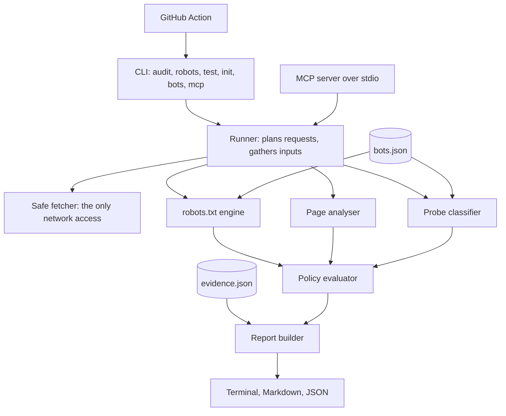

# Botpolicy: Open-Source AI Crawler Policy Checker Roadmap (built with Claude Code)

Nov 14, 2026

A public, MIT-licensed CLI and MCP server that tells a site owner what each AI crawler can actually reach on their site, and fails CI when that drifts from the policy they wrote down. Built in small verified steps with Claude Code, launched in roughly 4 to 5 weeks of part-time work.

## Read this first: the niche is crowded

The first pitch was a general "AI visibility auditor" that scores a URL. A check on Nov 14 found at least ten open-source tools that already do that, several with a CLI plus an MCP server or a GitHub Action. A straight copy would start behind all of them.

| Existing tool | What it is | Stars (Nov 14) |
| --- | --- | --- |
| [geo-optimizer-skill](https://github.com/Auriti-Labs/geo-optimizer-skill) | Python CLI and MCP; scores a site 0 to 100 and writes fixes; 1,104 commits | 1.3k |
| [geo-aeo-tracker](https://github.com/danishashko/geo-aeo-tracker) | TypeScript tracker, CLI and MCP; audit plus brand tracking in AI answers | 252 |
| [ai-crawler-bots](https://github.com/TryGeoSuite/ai-crawler-bots) | Node CLI and Action; robots.txt verdicts, status-code probe per bot, assert flags | 2 |
| [plugd](https://github.com/mdayan8/plugd) | CLI, MCP, Action; 21 crawlers, robots.txt and CDN, fix plan | 0 |
| [robotspec](https://github.com/iamnarace/robotspec) | Python; a policy file for robots.txt, tested in CI | not checked |
| [crawlcheck-core](https://github.com/emmanuelorta/crawlcheck-core) | JS library; per-agent robots.txt policy, group shadowing, log verification | not checked |

Two lessons from that table: two complete tools sit at 0 and 2 stars, so shipping the code is not what earns attention; and the one clear leader got there with over a thousand commits.

**What is still open (screened by reading READMEs, not proven):** no tool found combines all three of these.

1. **The whole stack, per crawler.** robots.txt is one of five places a crawler gets allowed or refused. The others are `X-Robots-Tag` headers, robots meta tags and snippet controls, the CDN or firewall, and whether the page has any text without JavaScript. The tools above each cover one or two.
2. **A written policy, checked both ways.** Most tools assume more access is better. Real owners want a split, such as search crawlers in and training crawlers out, and need to know when the live site stops matching. robotspec does this for the robots.txt file only.
3. **Evidence on every check.** Several tools award points for `llms.txt`, a file the measurements say AI search crawlers almost never fetch (see Sources). Botpolicy cites a source for each check and gives unproven ones no weight.

The problem itself is measured: in a HasData study reported by [PPC Land](https://ppc.land/cloudflare-drops-ai-opt-outs-from-118-sites-robots-txt-hasdata-finds/), 234 of 592 sites that disallow GPTBot in robots.txt still served it a live page, and 178 sites blocked GPTBot at the firewall while their robots.txt said nothing.

Phase 0 ends with a go or no-go on this wedge. If it fails, stop and tell the owner before writing features.

## Locked defaults

Every open question is settled below so Claude Code can start without asking the owner anything. The owner can change any row and the rest of the plan follows.

| Decision | Default | Change it if |
| --- | --- | --- |
| Name | `botpolicy` (npm name free on Nov 14); backups `crawlpolicy`, then `crawlcontract` | The Phase 0 name check finds a conflict |
| Repo | `lawless-commits/botpolicy`, public from the first commit, MIT license | The owner wants it under another account |
| Wedge | Whole-stack access per crawler, a policy file checked in CI, evidence on every check | The Phase 0 wedge check finds a tool that already does all three |
| Audience | Developers and site owners who deploy their own site; not marketers | Launch feedback says otherwise |
| Shape | One npm package: CLI, library and MCP server (`botpolicy mcp`), plus a GitHub Action in the same repo | The package grows past what one install should carry |
| Language and tools | TypeScript, Node 22 or newer, pnpm, Vitest, ESLint, GitHub Actions; plain `tsc` build | The owner prefers another stack |
| Dependencies | As few as possible: the MCP SDK, zod, one HTML parser; CLI flags through `node:util` | A dependency removes real risk |
| Output | An access table per crawler purpose and a findings list; no 0 to 100 score | Users ask for a single number |
| Network behaviour | Passive by default (robots.txt and the pages asked for, honest user agent); crawler-impersonating requests only with `--probe` | Never loosened without the owner |
| Headless browser | None in v1; JavaScript dependence is judged from the raw HTML | Users need a rendered comparison (Phase 7) |
| Policy file | `botpolicy.json` with a published JSON Schema | Users ask for YAML or TOML |
| Crawler list | About 15 crawlers at launch, each with the operator's own documentation link and a verified date | A crawler has no operator documentation (then it is listed as unverified) |
| Publishing | Claude prepares; the owner approves every npm publish, release, registry listing and public post | Never |
| Telemetry | None | Never |

## How to start in Claude Code

This file is the spec. Save it in the repo as `docs/roadmap.md`, put `CLAUDE.md` in the repo root, start Claude Code with `claude`, and paste the kickoff prompt.

**Kickoff prompt**

```text
Read CLAUDE.md and docs/roadmap.md fully, including "Read this first" and the Locked defaults. We are
starting Phase 0. Make a short plan first, then scaffold the package exactly as the roadmap describes:
TypeScript, pnpm, Vitest, ESLint, GitHub Actions CI, MIT license, and a CLI entry point that prints
its version. Run the name check and the wedge check from Phase 0 and record both in docs/decisions.md.
Fill in the Commands list in CLAUDE.md. Do not ask me about choices the roadmap already makes. Stop at
the Phase 0 gate and tell me what you did, what the wedge check found, and what I need to set up by hand.
```

**Accounts and keys**

| Service | Needed for | Secrets | When |
| --- | --- | --- | --- |
| GitHub | Public repo, CI, releases, the Action | none | Phase 0 |
| npm | Publishing the package | Prefer npm trusted publishing from GitHub Actions; otherwise `NPM_TOKEN` as a repo secret | Phase 6, but create the account and reserve the name in Phase 0 |
| MCP Registry | Listing the server | GitHub login through `mcp-publisher` | Phase 6 |

No API keys are needed to run the tool. Keep any token out of this file and out of git.

## Goal and scope

**In scope (v1)**

- A sourced registry of AI crawlers, grouped by purpose: training, search, and user-triggered fetch
- A robots.txt engine that follows RFC 9309 and names the line that decided each verdict
- Page checks: `X-Robots-Tag`, robots meta tags, snippet controls, canonical, text present without JavaScript, JSON-LD that parses
- An opt-in probe that requests a page as each crawler and classifies the response
- A policy file, `botpolicy init` to write one from current behaviour, and `botpolicy test` for CI
- Reports as terminal text, Markdown and versioned JSON
- A GitHub Action and a read-only MCP server over the same core

**Out of scope (v1)**

- Tracking whether AI answers mention a brand (needs paid API keys; the leaders already do it)
- Generating or scoring `llms.txt`; it is reported as informational only
- Writing fixes into a site or its repo
- A hosted web app, accounts or a dashboard
- Server log analysis, headless rendering, full schema.org validation
- Agentic checkout protocols (UCP, ACP); that niche has its own crowd of checkers

## Architecture

### Principles

- **One core, three thin shells.** The CLI, the MCP server and the Action call the same functions and return the same report.
- **The core is pure.** It takes text and returns findings. It never touches the network or disk, so every rule is tested with fixtures.
- **One door to the network.** A single fetcher holds every safety rule: address checks, size caps, timeouts, request budget.
- **Measured or not measured.** An unreachable file is reported as not measured. It is never turned into a verdict.
- **Data, not code, for facts that change.** Crawlers and evidence live in JSON files with sources and dates.

### Modules



### Folder layout

```text
botpolicy/
  src/
    core/            pure functions, no I/O
      robots/        parse, match, explain (RFC 9309), content signals
      page/          headers, meta, snippet controls, no-JS text, JSON-LD
      probe/         classify a crawler response against the baseline
      policy/        schema, load, evaluate
      report/        findings to terminal, Markdown, JSON
      types.ts       BotRecord, Finding, Verdict, Report
    data/
      bots.json      crawler registry
      evidence.json  one entry per check: level, source, date
    net/fetcher.ts   the only module that makes requests
    runner.ts        turns a command into requests and core calls
    cli.ts           flags and exit codes
    mcp.ts           tools mapped to runner calls
  action.yml         GitHub Action
  schema/            JSON Schemas for the policy file and the report
  fixtures/          robots.txt files, HTML pages, a local test server
  docs/              roadmap.md, decisions.md, checks.md
```

### What one run does

1. Read the target and the policy file, if there is one.
2. Fetch `/robots.txt` once, with the tool's own user agent.
3. Fetch each listed path once with the same user agent. This is the baseline.
4. With `--probe` only: fetch each path again as each crawler in scope, one request a second, inside the request budget.
5. Run the core: robots verdicts, page findings, probe classification.
6. Combine them into one effective verdict per crawler and path, keeping the reason for each layer.
7. Compare against the policy and write the report. Set the exit code.

### Data model

- **BotRecord:** token, operator, purpose (`training`, `search`, `user-fetch`, `other`), example user-agent string, whether the operator says it follows robots.txt (`yes`, `no`, `unstated`), documentation URL, date verified.
- **Finding:** check ID, layer (`robots`, `page`, `edge`, `info`), severity, the crawlers and path it applies to, a one-line reason, the evidence entry.
- **Verdict:** per crawler and path: `allowed`, `blocked`, `restricted` (reachable but limited by a page-level control), or `not measured`, with the layer that decided it.
- **Report:** schema version, target, time, verdict table, findings, policy result.

### Check catalogue

Evidence levels: **documented** means the crawler's operator describes the behaviour; **measured** means an independent study with a published method; **unproven** means neither, and the check carries no weight.

| ID | Layer | What it checks | Evidence |
| --- | --- | --- | --- |
| R1 | robots | robots.txt fetch status, handled as RFC 9309 says | documented |
| R2 | robots | Verdict per crawler and path, with the deciding line | documented |
| R3 | robots | A crawler-specific group that drops rules the owner set under `*` | documented |
| R4 | robots | Rules aimed at retired tokens (`anthropic-ai`, `Claude-Web`) | documented |
| R5 | robots | A search crawler blocked when only its training sibling was meant, or the reverse | documented |
| R6 | robots | `Content-Signal` lines and managed blocks a CDN added | documented |
| R7 | robots | Sitemap declared and reachable | documented |
| P1 | page | `X-Robots-Tag` header, including crawler-scoped values | documented |
| P2 | page | Robots meta tags, `nosnippet`, `max-snippet`, `data-nosnippet` | documented |
| P3 | page | Status, redirects, canonical pointing elsewhere | documented |
| P4 | page | Enough readable text in the raw HTML, without JavaScript | to confirm in Phase 2 |
| P5 | page | JSON-LD blocks parse and declare a type | documented |
| E1 | edge | Response to each crawler's user agent against the baseline: served, denied, challenged, different | measured |
| I1 | info | `llms.txt` present; reported, never weighted | unproven |

Each row's source goes into `evidence.json` in Phase 2; a test fails the build if a check has none.

### Policy file

```json
{
  "$schema": "https://unpkg.com/botpolicy/schema/policy.json",
  "site": "https://example.com",
  "paths": ["/", "/blog/", "/products/sample"],
  "rules": [
    { "bots": "purpose:search", "expect": "allowed" },
    { "bots": "purpose:user-fetch", "expect": "allowed" },
    { "bots": "purpose:training", "expect": "blocked" },
    { "bots": ["GPTBot"], "paths": ["/press/"], "expect": "allowed" }
  ],
  "page": { "minTextWithoutJs": 500, "requireJsonLd": ["Product"] }
}
```

The shape is a draft; Phase 3 fixes it and publishes the schema.

### Interfaces

| Command | Does |
| --- | --- |
| `botpolicy audit <url>` | Full report for one site; add `--probe` for the edge layer |
| `botpolicy robots <url or file>` | robots.txt verdicts only, with deciding lines; works offline on a file |
| `botpolicy init <url>` | Writes `botpolicy.json` from what the site does today |
| `botpolicy test` | Checks the site against `botpolicy.json` |
| `botpolicy bots` | Lists the registry, with sources |
| `botpolicy mcp` | Starts the MCP server over stdio |

Exit codes: `0` policy holds, `1` policy broken, `2` bad flags or policy file, `3` could not measure.

MCP tools, all read-only: `audit_site`, `check_policy`, `explain_verdict`, `list_bots`, `draft_robots_rules` (returns text; never writes a file).

The Action runs `botpolicy test` against a URL, such as a deploy preview, writes a job summary, and is meant to run on pull requests and on a weekly schedule, because a CDN setting can change without a commit.

### Safety and manners

- The fetcher resolves the host and refuses private, loopback and link-local addresses, on the first request and on every redirect.
- Limits: 10-second timeout, 2 MB body, 5 redirects, 40 requests a run unless the owner raises it.
- The default user agent names the tool and links to the repo.
- A probe result is always labelled simulated. Large CDNs verify real crawlers by IP address, so a refusal of our request does not prove the real crawler is refused; the report says so.

## Roadmap

Seven phases (plus Phase 6b), each ending in a gate the owner can check. Do not start the next phase until the gate passes. Time estimates assume 8 to 10 hours a week.

1. **Phase 0: Foundations and wedge check (day 1-2).** Create the public repo, scaffold the package, add CI, the license and `CLAUDE.md`. Check the name on npm and GitHub. Re-read the READMEs of the tools in "Read this first" and search for newer ones.
   - Done when: CI passes on a pull request; `npx` runs the packed tarball and prints a version; `docs/decisions.md` records the name check and a go or no-go on the wedge.
2. **Phase 1: Crawler registry and robots.txt engine (week 1).** `bots.json` with sources; parser, matcher and explainer; status handling; group shadowing; content signals.
   - Done when: the RFC 9309 examples and the fixture files pass; `botpolicy robots <url>` prints a verdict and deciding line per crawler; an unreachable robots.txt prints "not measured" and exits 3.
3. **Phase 2: Page layer and the audit command (week 1-2).** Safe fetcher, header and meta checks, no-JS text, JSON-LD, `evidence.json`, the three report formats.
   - Done when: `botpolicy audit` gives the expected findings on five local fixture sites (clean, blocked in robots.txt, `noindex` header, empty JavaScript shell, CDN-managed robots.txt); the JSON validates against its schema; the fetcher refuses a private address.
4. **Phase 3: Policy file, test command and Action (week 2-3).** Policy schema, `init`, `test`, exit codes, the Action and its job summary.
   - Done when: in a demo repo, a pull request that breaks the policy fails CI and names the deciding line, and the fix passes.
5. **Phase 4: Edge probe (week 3).** `--probe`, the response classifier, rate limit, request budget, the simulated label.
   - Done when: the classifier is right on a local server that refuses, challenges and alters responses by user agent; a probe of a site the owner controls matches what its host or CDN dashboard shows; a run never exceeds the budget.
6. **Phase 5: MCP server (week 3-4).** stdio server with the five tools over the same runner.
   - Done when: the MCP Inspector lists the tools; Claude Code, after `claude mcp add`, runs an audit; tool output equals the CLI's JSON for the same input.
7. **Phase 6: Launch (week 4-5).** README with a demo GIF at the top and a three-step quickstart, `docs/checks.md`, version 1.0.0, npm publish, MCP Registry listing, launch posts.
   - Done when: `npx botpolicy audit <url>` works on a machine that has never seen the repo; the registry lists the server; the owner has approved and posted the launch.

**Phase 6b: The survey (week 4-5, before the launch post).** Run the tool with `--probe` over a public list of a few hundred sites and publish the method, the data and a short write-up: how often the live site contradicts its robots.txt. A South African list is the suggested first cut. Existing local studies read robots.txt only ([Daily Maverick](https://dailymaverick.co.za/article/2026-09-01-extraction-without-compensation-the-ai-dilemma-facing-sas-digital-media) on 263 news sites; [Zyte](https://www.zyte.com/sowa/2026/geo/country/af-za) on 1,111 sites), and no local enforcement-gap study turned up in one search. Done when: anyone can rerun it from the repo and get the same table; the owner has read every claim in the write-up.

**After launch (ongoing).** Answer every issue within a day. Verify the registry weekly. Then, in order of requests: `--render` with an optional headless browser, a `logs` command, YAML policy files.

## What success looks like

- **Targets, not forecasts.** By day 30: the launch post is live, 5 people who are not the owner have opened an issue or pull request, and one other repo uses the Action. By day 90: 100 stars. Comparable tools range from 0 to 1.3k.
- **What moves the number.** The survey and the write-up, a README a stranger can act on in 30 seconds, and fast replies. Not more features.
- **What it does for the account.** The account's ten repos were all private when checked today, so a profile visitor sees nothing. One public, used, well-kept project is a hiring and client signal. It does not add sale value on its own; revenue from a product such as TradiePro does that.
- **Stop rule.** If the launch and the survey bring fewer than 15 stars in 30 days, keep the repo tidy, stop adding features, and put the hours back into a product.

## Working with Claude Code

The loop that keeps quality high is: plan, build one slice, test, review, commit.

- **Write `CLAUDE.md` first.** Stack, layout, commands, and the rules that never bend.
- **Plan before code.** Start each phase in plan mode; approve the step list, then build.
- **One slice per branch.** Small enough to review in 10 minutes. Merge through pull requests so CI runs.
- **Failing test first** for the robots.txt engine, the policy evaluator, the probe classifier and the fetcher's address checks.
- **Fixtures over live sites.** Tests never call the internet.
- **Look things up.** The MCP TypeScript SDK moved to version 2 this year; read its current docs before writing `mcp.ts`. Check each crawler's own documentation before adding it.
- **Use hooks for guardrails.** Run lint and tests after edits, and block edits to `.env` files.
- **Fresh context per phase.** Let `CLAUDE.md` carry the memory.
- **Review these diffs yourself:** the fetcher, anything that changes a verdict, and every release.

## Starter prompts

Paste one per phase. Each asks for a plan first.

| Phase | Prompt |
| --- | --- |
| 0 | Scaffold a TypeScript package with pnpm, Vitest, ESLint and GitHub Actions CI. Add the MIT license and a CLI that prints its version. Run the name check and the wedge check and record both in docs/decisions.md. Plan first. |
| 1 | Plan the crawler registry and the robots.txt engine. Show the BotRecord shape and the list of crawlers with the operator documentation you checked for each. Write failing tests from RFC 9309 and the fixtures first, then implement parse, match and explain. |
| 2 | Plan the safe fetcher and the page analyser. Write the failing tests for address refusal, size and redirect limits first. Then build the checks in the catalogue, evidence.json with a source per check, and the three report formats. |
| 3 | Design the policy schema and show three example files before writing code. Build init and test with the exit codes in the roadmap, then the GitHub Action with a job summary. |
| 4 | Plan the probe: request budget, rate limit, the four response classes and how each is detected. Build the local test server and the failing tests first. Every probe result must carry the simulated label. |
| 5 | Read the current MCP TypeScript SDK docs, then plan the stdio server and its five read-only tools over the existing runner. Test it with the MCP Inspector. |
| 6 | Draft the README, docs/checks.md, the release notes and the launch post. Prepare the npm publish and the MCP Registry entry, and stop for my approval before anything goes public. |
| 6b | Plan the survey: the site list and its source, the request budget, what is recorded and what is published. Build it as a script in the repo that anyone can rerun. Draft the write-up from the data only. |

## Risks and what not to build

- **Crowded niche.** The biggest risk. The wedge check in Phase 0 and the stop rule are the answers; a feature race with the leader is not.
- **Wrong verdicts.** One false "blocked" in a launch post costs the project its credibility. Fixtures, deciding lines and the "not measured" rule exist for this.
- **Stale crawler facts.** Operators rename crawlers and change their robots.txt stance. Every record carries a source and a date; unverified ones are marked.
- **Probing sites the owner does not control.** Keep it opt-in, slow and capped. The survey uses a small budget per site and publishes its method.
- **An MCP server that fetches URLs.** It can be pointed at internal addresses. The address checks in the fetcher are not optional.
- **Scope creep.** Brand tracking, fix generation and a web app wait until there are real users asking.
- **Do not build yet:** a score, an `llms.txt` generator, a dashboard, a browser extension, or a paid tier.

## Open questions (answered by the defaults)

- **What it is:** a policy checker for AI crawler access, not a general SEO scorer.
- **Who it is for:** developers who ship their own site and want a CI check.
- **Why it would get noticed:** the whole-stack verdict, the survey, and honesty about what is and is not evidence.
- **What it costs to run:** nothing; no keys, no server.
- **Name:** `botpolicy`, until the Phase 0 check says otherwise.

## Facts the design rests on (checked Nov 14, 2026)

| Fact | Source |
| --- | --- |
| OpenAI lists four agents: GPTBot (training), OAI-SearchBot (search), ChatGPT-User (user actions) and OAI-AdsBot (ad landing pages). It says robots.txt rules may not apply to ChatGPT-User | [OpenAI crawler docs](https://developers.openai.com/api/docs/bots) |
| Anthropic lists ClaudeBot (training), Claude-User (user fetch) and Claude-SearchBot (search), says they honor robots.txt and `Crawl-delay`, and warns that IP blocking is not a reliable opt-out | [Anthropic help page](https://support.claude.com/en/articles/8896518) |
| Perplexity splits PerplexityBot (index) from Perplexity-User (retrieval) | [Search Engine Journal](https://www.searchenginejournal.com/anthropic-claude-bots-robots-txt-ai-decisions/568253/); confirm on Perplexity's own docs in Phase 1 |
| Google-Extended limits training and grounding in other Google systems, not AI Overviews or AI Mode; the page-level controls there are `nosnippet`, `data-nosnippet`, `max-snippet` and `noindex` | [Google Search Central](https://developers.google.com/search/docs/appearance/ai-features) |
| Since Jul 1, 2025 Cloudflare asks each new domain whether to allow AI crawlers, and blocks them by default | [LLMrefs](https://llmrefs.com/blog/cloudflare-blocks-ai-crawlers) |
| From Sep 15, 2026 Cloudflare sorts crawlers into Search, Agent and Training, and blocking Training also blocks mixed-purpose crawlers such as Googlebot and Bingbot | [Help Net Security](https://www.helpnetsecurity.com/2026/07/02/cloudflare-ai-crawler-controls/) |
| Cloudflare's managed robots.txt is prepended to the site's own file and carries `Content-Signal` lines | [Cloudflare docs](https://developers.cloudflare.com/bots/additional-configurations/managed-robots-txt/) |
| 97% of `llms.txt` files in an Ahrefs study received no requests in May 2026; Google says its Search AI features do not use such files | [Let's Data Science](https://letsdatascience.com/news/ahrefs-finds-97-of-llmstxt-files-receive-no-requests-fc471b83), [Optimizely](https://www.optimizely.com/field-notes/articles/does-llms-txt-work/) |
| The MCP TypeScript SDK is at 2.4.0 (Oct 23, 2026), with 1.32.2 still maintained | [Release list](https://releases.sh/modelcontextprotocol/mcp-typescript-sdk.md) |
| The MCP Registry stores metadata only; the package goes to npm first, then `mcp-publisher publish` | [Registry quickstart mirror](https://glama.ai/blog/2026-01-24-quickstart-publishing-a-server) |

## Name: botpolicy

The working name says what the tool does and reads well as a command (`botpolicy test`). Status: `npm view botpolicy` returned not found on Nov 14. That is a screen, not clearance.

- [ ] Reserve `botpolicy` on npm with a placeholder version
- [ ] Create `lawless-commits/botpolicy` as a public repo
- [ ] Search GitHub and npm for close names (`bot-policy`, `botpolicies`, `robotspec`) and note them in `docs/decisions.md`
- [ ] If any of that fails, move to `crawlpolicy`, then `crawlcontract`

## Next steps and sources

- [ ] Create an npm account and turn on two-factor sign-in
- [ ] Create the public repo and add this file and `CLAUDE.md`
- [ ] Paste the kickoff prompt and stop at the Phase 0 gate
- [ ] Pick the site the Phase 4 probe is checked against (one the owner controls)
- [ ] Decide the survey's site list before Phase 6b

**Sources:** competitor details and star counts were read from each project's GitHub page on Nov 14, 2026 and will move. Study figures come from news coverage and search excerpts, not the full reports; read the originals before quoting them in the launch post: [PPC Land on HasData](https://ppc.land/cloudflare-drops-ai-opt-outs-from-118-sites-robots-txt-hasdata-finds/), [Optimizely on llms.txt](https://www.optimizely.com/field-notes/articles/does-llms-txt-work/), [Daily Maverick](https://dailymaverick.co.za/article/2026-09-01-extraction-without-compensation-the-ai-dilemma-facing-sas-digital-media), [Zyte State of Web Access](https://www.zyte.com/sowa/2026/geo/country/af-za), [awesome-ai-visibility](https://github.com/KarimMeziti/awesome-ai-visibility), [ai.robots.txt](https://github.com/ai-robots-txt/ai.robots.txt).
